<h1 align="center">Hi, I'm Ahmed Hemeda</h1>
<h2 align="center">Software Engineer | Full Stack Developer</h2>

  <a href="https://www.google.com.eg/search?q=Ahmed+Hemeda"> <!-- Google Me -->

  

  

    <a href="https://www.google.com.eg/search?q=Ahmed+Hemeda"> <!-- Google Me -->
      </a>
  

  ### 📤 Find me on
  

     &nbsp;
     &nbsp;
     &nbsp;
     &nbsp;
     &nbsp;
    
  

  

    
  

  <picture>
    <source media="(prefers-color-scheme: dark)" srcset="https://raw.githubusercontent.com/A-Hemeda/A-Hemeda/output/pacman-contribution-graph-dark.svg" />
    <source media="(prefers-color-scheme: light)" srcset="https://raw.githubusercontent.com/A-Hemeda/A-Hemeda/output/pacman-contribution-graph.svg" />
    
  </picture>

